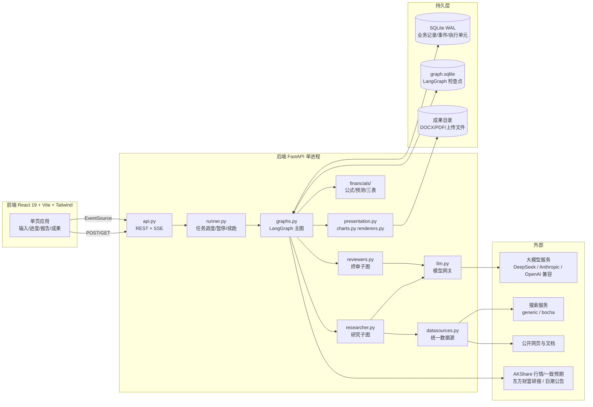
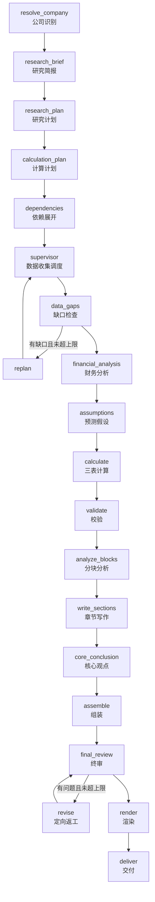
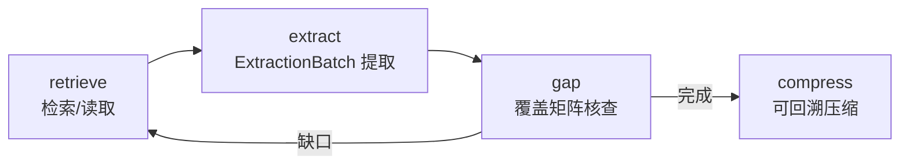
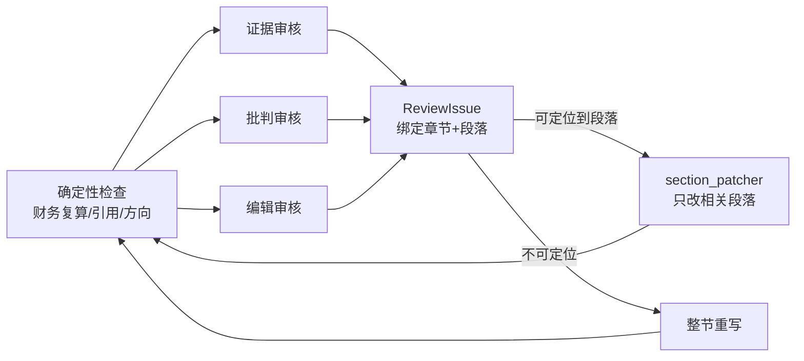
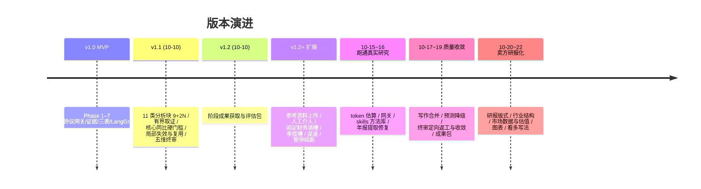

# Company Deep Research Agent 项目介绍

> 上市公司深度研究智能体：输入公司名称或证券代码，系统自动完成取证、财务分析、行业分析、盈利预测与估值、多轮审核，最终输出券商深度报告版式的 HTML / DOCX / PDF 研报。
>
> 文档日期：2026-10-23　｜　当前分支：`claude/review-convergence`　｜　适用版本：PRD v1.2 + 2026-10-15 ~ 10-22 迭代

---

## 目录

1. [项目定位](#1-项目定位)
2. [核心功能](#2-核心功能)
3. [设计理念与关键原则](#3-设计理念与关键原则)
4. [系统架构](#4-系统架构)
5. [研究流程详解](#5-研究流程详解)
6. [数据与证据体系](#6-数据与证据体系)
7. [财务、预测与估值](#7-财务预测与估值)
8. [写作、审核与报告呈现](#8-写作审核与报告呈现)
9. [可靠性：断点续跑、成果包与阶段成果](#9-可靠性断点续跑成果包与阶段成果)
10. [模型网关与成本控制](#10-模型网关与成本控制)
11. [前端](#11-前端)
12. [工程与测试](#12-工程与测试)
13. [迭代记录](#13-迭代记录)
14. [已知边界](#14-已知边界)
15. [未来优化方向](#15-未来优化方向)
16. [附录：目录结构与文档索引](#16-附录目录结构与文档索引)

---

## 1. 项目定位

### 1.1 要解决的问题

人工撰写一份 A 股公司深度报告，需要读年报、查行业资料、搭三表模型、做预测和估值，再写成几十页的研报，周期通常以周计。直接让大模型"写一份研报"又存在三类根本问题：

| 问题 | 表现 |
|---|---|
| **事实不可靠** | 数字凭记忆编造、口径混用（合并/归母、年度/单季）、引用无法追溯 |
| **长上下文遗漏与截断** | 一次塞入全部年报和问题，模型遗漏必需维度，输出被截断 |
| **失败代价高** | 长流程中任何一步失败都要从头再来，token 成本不可控 |

本项目的目标是：**以固定研究框架组织多次有界的模型调用，用程序保证事实、数字和流程的正确性，用模型负责理解、提取、分析和写作**，在有限预算内产出可追溯、可审核、可续跑的深度研报。

### 1.2 适用范围

- 优先支持 **中国 A 股非金融企业**。
- 历史范围：最新三个完整财年 + 最新可用中报/季报（另读取一个前序年作为同比基数）。
- 预测范围：未来三个财年，Bear / Base / Bull 三情景。
- 运行形态：**本地单进程 MVP**（单用户、单 worker），不含账户、聊天、多租户或公网部署能力。

### 1.3 两种运行模式

| 模式 | 说明 |
|---|---|
| `mock`（默认） | 不需要任何密钥。任意输入都映射到虚构的 "DEMO 制造企业" 合成资料，全流程照常执行并明确标注"模拟"，用于开发、测试与演示 |
| `real` | 接入真实大模型（OpenAI-compatible / Anthropic-native）与搜索服务，读取用户上传的年报与公开资料，产出真实研究 |

---

## 2. 核心功能

### 2.1 用户可见功能

| 功能 | 说明 |
|---|---|
| **一键研究** | 单页输入公司名称/代码，点击"开始研究"即创建任务 |
| **参考资料上传** | 启动页上传年报、季报、中报、研报等（PDF/DOCX/XLSX/CSV/TXT/MD/HTML/JSON），绑定到本次研究，优先级最高 |
| **卖方看多写法（可选）** | 研究开始前勾选"采用卖方看多逻辑写法"，写作加载看多风格并启用看多估值模型 |
| **实时进度** | SSE 推送节点级事件：累计耗时、已完成阶段、并行任务、资料/证据/事实/计算/草稿数量、问题覆盖、模型请求次数与 token 用量 |
| **固定数据表查看** | 查看财务与证券固定字段的填槽状态，以及行业资料各方向的覆盖情况 |
| **人工数据核验** | 核心数据冲突或缺失时，生成人工待办；用户可选候选值、补充原文摘录或提供补查方向 |
| **暂停 / 继续 / 调整预算** | 随时暂停（已发请求保存结果），从断点继续；预算耗尽可提高上限后继续 |
| **阶段成果与评估包** | 运行中、阻断、失败时都可查看已保存成果，并导出 ZIP / JSON / Markdown 评估包 |
| **成果包导出与续做** | 导出已停止任务的成果包，下次在首页上传，沿用已完成阶段与合格章节，只重做不合格部分 |
| **报告阅读与下载** | 页面内嵌服务端渲染的研报 HTML，下载 DOCX / PDF（三者版式一致） |

### 2.2 报告产出内容

报告采用券商深度研报版式，固定结构如下：

```
封面 / 核心观点（核心逻辑、盈利预测与投资建议、风险提示 + 盈利预测小表）
目录（含图表索引）
一、公司情况        —— 公司概况、股权治理、业务结构、成本结构、客户/供应商集中度
二、业务情况        —— 每项业务：行业判断标题 + 产品与工艺 / 供给格局（厂商产能对比）
                       / 需求与规模 / 价格驱动 / 上游与成本 / 下游与渠道 / 政策 + 公司定位
三、盈利预测与估值  —— 业务拆分及关键假设表、主要预测假设、盈利预测与估值汇总、
                       情景分析、可比公司估值、（看多模式）看多估值表
四、风险提示
附录                —— 资产负债表、利润表、现金流量表、主要财务比率
```

- 图表自动生成并编号（图 N / 表 N，附"数据来源"）：柱状+增速折线、比率折线、单季度、堆叠、饼图、行业走势、分业务毛利率、厂商对比等。
- 金额统一换算为亿元/万元；段首论点句加粗；正文不出现内部记录 ID 或审核措辞。
- 每个数字都通过占位引用绑定到事实、计算或行业数据，可回溯至原文页码。

---

## 3. 设计理念与关键原则

### 3.1 "程序管骨架，模型管内容"

| 由程序确定（确定性） | 由模型完成（语义性） |
|---|---|
| 研究框架、分析块、必需问题、依赖关系 | 细化问题、检索词、可选问题 |
| 固定财务字段表（七区 133 个原始字段） | 从年报中提取并定位数值 |
| 公式注册表、Decimal 计算、三表联动 | 预测假设（带证据） |
| 同比表、增减额、特殊变动状态 | 分析结论、写作、反思 |
| 引用校验、数字绑定、方向一致性检查 | 证据/批判/编辑三类语义审核 |
| 报告版式、图表、编号、单位换算 | 观点式标题、段落论述 |

**模型输出永远不是事实来源**。所有数字必须能在原文中逐字定位，否则隔离；写作中的数字由模型写占位符、程序填值。

### 3.2 核心原则

1. **证据链完整**：`source → evidence → fact → calculation → section`，每一环可追溯。
2. **口径不混用**：合并/母公司/分部、实际/预测、年度/累计/单季、单位、币种分开存储，绝不静默合并。
3. **缺失显式处理**：缺数据就标注缺口或关闭依赖功能，**绝不填零或估造**。
4. **有界执行**：研究轮数、补查、拆批、重试、终审返工、token 都有外置上限。
5. **局部失效与复用**：上游变化通过依赖图让下游失效；未受影响的单元直接复用。
6. **质量门槛不可绕过**：核心同比缺失、确定性校验失败时阻断正式交付；续跑、人工介入、成果包都不能跳过审核。
7. **资料是数据不是指令**：来源内容以 JSON 数据进入 Prompt，不执行其中的任何指令。
8. **任务隔离**：恢复只使用原 `run_id` 的检查点；不同任务的事实与缓存互不混用。

### 3.3 数据来源优先级

```
用户上传参考资料  >  人工确认  >  财务接口 / 公司官方报告  >  其它来源
```

上传资料能提供的字段只从上传资料取，不再发起外部检索；外部检索只补缺失项。

---

## 4. 系统架构

### 4.1 总体架构



### 4.2 技术栈

| 层 | 技术 |
|---|---|
| 前端 | React 19、TypeScript 5.8、Vite 8、Tailwind CSS 4、Vitest、Playwright |
| 后端框架 | Python 3.11+（实测 3.12）、FastAPI、Uvicorn、Pydantic v2、pydantic-settings |
| 编排 | LangGraph 1.x + `langgraph-checkpoint-sqlite`（AsyncSqliteSaver） |
| 存储 | SQLite（WAL 模式），单库多表 |
| 文档解析 | pypdf、python-docx、openpyxl、BeautifulSoup4 |
| 渲染 | python-docx（DOCX）、ReportLab（PDF，多遍排版）、自研 SVG/PNG/矢量图元 |
| 市场数据 | AKShare（巨潮行业、申万成份、新浪行情、同花顺一致预期、东方财富 PE 历史） |
| 网络 | httpx（连接池、Retry-After 退避） |
| 工程 | ruff 格式化、pytest + pytest-asyncio |

### 4.3 后端模块地图

| 分组 | 模块 | 职责 |
|---|---|---|
| **入口与调度** | `api.py` | REST/SSE 接口、上传、下载、恢复、预算调整 |
| | `runner.py` / `startup.py` | 单 worker 任务执行、暂停收尾、启动时任务状态整理 |
| | `config.py` | 环境变量配置（`CDR_*`） |
| **编排** | `graphs.py` | 主图节点实现与连线（最大模块，约 2400 行） |
| | `researcher.py` | 研究子图：retrieve → extract → gap → 补查/compress |
| | `execution.py` | 执行单元台账：按输入指纹记录/复用节点与子步骤结果 |
| | `framework.py` / `planners.py` | 11 类分析块模板、必需问题、Plan 校验与修复 |
| **数据采集** | `datasources.py` | Local + Web 统一数据源、SSRF 防护、搜索 Provider |
| | `fixed_collection.py` | 固定财务/证券字段填槽（窗口拆分、逐值校验） |
| | `material_collection.py` | 业务/行业资料包按方向检索与覆盖 |
| | `annual_reports.py` / `annual_identity.py` / `reporting_periods.py` | 上传年报清单、证券身份确认、期间判定 |
| | `standard_tables.py` / `table_columns.py` / `cost_structure.py` | 表头解析、标准表与成本构成确定性抽取 |
| | `industry_data.py` / `research_reports.py` / `peer_disclosures.py` / `market_data.py` | 行业数据、卖方研报、同行公告、AKShare 行情 |
| | `references.py` | 用户参考资料上传与绑定 |
| **证据与核验** | `evidence.py` | source → evidence → fact 证据库 |
| | `reconciliation.py` | 财务候选裁决、更正公告补查、局部失效 |
| | `human_intervention.py` | 人工核验待办、反馈校验、waiting_human 状态 |
| | `isolation.py` | 任务隔离标记与检查 |
| **财务** | `financials/formulas.py` | 公式注册表（参数、版本、单位） |
| | `financials/forecast.py` / `generic.py` | 分部预测、三表联动、历史趋势通用模型 |
| | `comparisons.py` | 年度/中期同比表与特殊变动状态 |
| | `valuation.py` | 可比 PE、看多估值（历史中枢 + 龙头溢价） |
| **分析与写作** | `contexts.py` | 按块筛选上下文、记录 sent_context |
| | `agents.py` / `methods.py` | 各角色调用、skills 方法库注入 |
| | `writers.py` | 分块写作、反思、拆分合并、数字绑定 |
| | `text_checks.py` | 方向一致性、缺口措辞、内部措辞等确定性检查 |
| | `reviewers.py` | 五维终审、ReviewIssue 定位、返工路由 |
| **呈现** | `presentation.py` / `charts.py` / `renderers.py` / `reports.py` | 读者版式、图表、HTML/DOCX/PDF |
| **成果** | `work_products.py` / `resume_packages.py` | 阶段成果快照与评估包、成果包导出/上传续做 |
| **基础** | `llm.py` / `storage.py` / `schemas.py` | 模型网关、SQLite 存储、Pydantic 模型 |
| **Prompts** | `prompts/*.txt`（23 个） | 各角色提示词、`style.txt` / `style_bullish.txt` 写作风格 |

### 4.4 API 一览

| 方法 | 路径 | 用途 |
|---|---|---|
| POST | `/api/research` | 创建研究任务 |
| GET | `/api/research/{run_id}` | 状态、限制、可下载格式 |
| GET | `/api/research/{run_id}/events` | SSE 事件流（支持 Last-Event-ID） |
| GET | `/api/research/{run_id}/report` | 结构化 JSON / `format=html` |
| GET | `/api/research/{run_id}/download` | `format=docx|pdf` |
| GET | `/api/research/{run_id}/work-product[/download]` | 阶段成果预览 / 评估包下载 |
| POST | `/api/research/{run_id}/pause` · `resume` · `cancel` | 暂停、续跑 |
| GET | `/api/research/{run_id}/recovery` | 恢复位置、已保存单元、预算 |
| POST | `/api/research/{run_id}/budget` | 提高续跑预算 |
| GET | `/api/health` | 服务状态与模式 |

任务终态：`completed`（完成）/ `limited`（仅非核心限制）/ `blocked`（核心数据或终审无法修复）/ `failed`（执行故障）/ `interrupted`（中断）/ `waiting_human`（等待人工）。

---

## 5. 研究流程详解

### 5.1 主图



每个节点执行后：写入业务记录 → 记录执行单元 → 保存检查点 → 发出 SSE 事件。节点结果按输入指纹缓存，续跑时不重复外部调用。

### 5.2 研究框架：11 类分析块（9 + 2N）

| ID | 分析块 | 核心内容 |
|---|---|---|
| C01 | 公司概况与研究边界 | 身份、股权治理、业务划分、口径与范围 |
| F01 | 财务增长与盈利能力 | 收入/成本/利润同比、毛利率、费用率 |
| F02 | 资产负债与偿债能力 | 杠杆、流动性、营运风险 |
| F03 | 现金流与利润质量 | 经营现金流、营运资本、资本开支、FCF |
| F04 | 分业务财务表现 | 各业务收入、毛利、量价结构 |
| F05 | 资本配置与股东回报 | ROE/ROIC、研发、分红、回购 |
| I01 × N | 每项业务的行业分析 | 产品工艺、供给（厂商产能）、需求规模、价格、上下游、政策 |
| B01 × N | 每项业务的公司分析 | 产品、客户、产能、竞争位置、壁垒 |
| V01 | 盈利预测与估值 | 分业务假设、三表、三情景、估值 |
| R01 | 风险与反证 | 反例、触发条件、影响方向 |
| X01 | 整体综合与核心观点 | 现金与增长匹配、预测总量约束、估值依据、集中度 |

依赖顺序：`C01 → {F01, F02, F03, F05, 各 I01} 并行 → 对应 B01 → F04 → V01 → R01 → X01`。Supervisor 确定性地选择依赖已完成的任务，受并发上限约束。

### 5.3 研究子图（Researcher）



- 来源全文持久化；相关段落/表格带表头、单位、脚注、原文偏移进入批次；跨页表合并保留页标记。
- 提取输出逐项绑定原文，数值与引句必须逐字可定位，无效结果隔离并登记。
- 截断 / 不完整 / 超容量时按行对半拆分重提（最小 1500 字），拆分键稳定，续跑不重复调用。
- 覆盖矩阵独立核查"问题是否被证据回答"，调用完成不等于覆盖。

### 5.4 固定财务与证券填槽

真实模式下财务数据不由 Plan 设计，而是开发者预设的 **固定字段表**（七区 133 个原始字段：证券与股本、利润表、资产负债表、现金流、补充披露、单业务、债券），程序按公司和期间实例化为"槽"，取数模块填槽，分析模块只读。

- 每个字段有必需性标记（I 身份 / C 核心比较 / M 三表依赖 / V 估值 / S 业务结构 / D 债务组件 / B 债券），缺失后果由程序规则决定。
- 年报、季报、中报只来自本次用户上传；年报绑定本年 + 三年摘要前两年 + 1Q–4Q 单季度。
- 季度/中期槽中单季度与年初累计分开，最新累计期间及上年同期必须齐全。
- 负数与区间的区分、"不适用"占列、多种列头变体等表格解析细节由确定性代码处理。

### 5.5 行业资料收集

业务与行业资料按"方向"组织资料包：

| 方向 | 必需性 |
|---|---|
| 市场规模与结构 | 必需 |
| 产品与工艺 | 必需 |
| 主要厂商与产能 | 必需（逐家提取产能，生成厂商对比表/图） |
| 竞争格局（含各环节毛利与议价能力） | — |
| 上游原料与成本 / 下游需求与渠道 | 有资料才写 |
| 价格与周期 | 可选 |
| 政策（近三年窗口） | 可选，无资料不计缺口 |

来源除网页搜索外，还包括东方财富卖方深度研报、巨潮同行年报/招股书行业章节（计算样本口径 CR3/CR5）、年报成本构成表与前五名客户/供应商。`configs/source_domains.yaml` 屏蔽文档分享站与论坛、优先政府与交易所来源。行业数字以 `industry_data` 进入事实层，写作以 `[[ind:ID]]` 引用。

---

## 6. 数据与证据体系

### 6.1 数据源边界

- **UnifiedDatasource** 只组合 `LocalDatasource` 与 `WebAdapter`；搜索 Provider 可注入（`generic` 通用 JSON 合同 / `bocha`）。
- Web 读取限制大小、重定向次数，**每次跳转检查是否为公网地址**（防 SSRF）。
- Local 解析 PDF/DOCX/XLSX/CSV/TXT/MD/HTML/JSON，每段保存 page/table/row/cells 定位与内容哈希。
- 证据定位收敛为真实页码（`page:N chars a:b`），并通过 `llm_view` 对模型隐藏（曾占上下文约一半）。

### 6.2 证据链与核验

```
Source（来源，含全文与元数据）
  └─ Evidence（原文摘录 + 定位）
       └─ Fact（公司/指标/期间/单位/口径/实际或预测）
            └─ Calculation（注册公式 + 输入引用 + 版本）
                 └─ Section number_bindings（写作中的数字绑定）
```

- **财务核验**（`reconciliation.py`）：候选保留、单位与口径分离、原始披露及更正公告定向补查、证据裁决、局部失效与重算。
- **人工介入**（`human_intervention.py`）：补查耗尽的核心缺失/冲突生成人工待办；任务进入 `waiting_human` 时释放执行名额，反馈提交后自动排队续跑。
- **来源元数据**：同一来源标题/日期差异另存为观察记录，不覆盖、不阻断；正文、引用、口径冲突仍需审核。
- **同 ID 内容变化拒绝覆盖**，必须使用新 ID/版本。

---

## 7. 财务、预测与估值

### 7.1 计算引擎

- **Formula Registry**：集中定义公式参数、版本、输出单位；`DependencyResolver` 确定性展开依赖、去重、拒绝未知公式与循环。
- **Decimal 计算**：缺失、冲突、零分母、错误单位或期间一律不可用，不做隐式回退。
- **同比硬门槛**：营业收入、营业成本、归母净利润、扣非归母净利润、经营现金流五项核心指标，必须给出本期值、同期值、增减额、同比或特殊状态（零基数、扭亏、转亏、亏损收窄/扩大），否则阻断正式成稿。

### 7.2 盈利预测

| 模型 | 触发条件 | 方法 |
|---|---|---|
| 分部有据预测 | 模型给出的假设覆盖全部情景与年份且带证据 | 按情景/年度生成假设，三表引擎计算 |
| 公司口径预测 | 分部数据不完整 | 按公司整体口径预测，支持少数股东损益 |
| 历史趋势通用模型 | 有据假设未覆盖全部情景/年份 | 分业务增速由近年与复合增速推导并逐年收敛；比例按近三年加权；Bear/Bull 增速 ±5pct、毛利率 ∓1pct |

派生期初项、"其他业务收入"等均为可追溯的历史计算，不使用占位引用。独立 Reviewer 复算并校验 EPS/PE、分部合计、现金流与三表勾稽。

### 7.3 估值

- **可比估值**：AKShare 取申万同行与同花顺一致预期，目标 PE 取可比公司一致预期 PE 中位数。
- **看多估值**（看多模式）：目标 PE = 平均（公司近三年 PE(TTM) 中位数，可比 PE × ROE 优势溢价 1–1.5 倍），且不低于可比 PE 中位数；输出三情景目标价、空间与股息率，每步都是可复算的登记公式。

---

## 8. 写作、审核与报告呈现

### 8.1 写作

- **按块/小节调用**：财务章由 F01–F05 五次写作组装；行业章以 `parts` 标记小节（topic、观点标题、起始段）。
- **数字占位**：Writer 写 `[[fact:…]]` / `[[calc:…]]` / `[[ind:…]]` 引用，Python 填数并保存 `number_bindings`。年份、报告期、日期可直接书写。
- **风格**：`style.txt` 参照券商深度报告写法——观点式标题、论点句 + 数据、每段 150–350 字；`style_bullish.txt` 为看多写法。
- **Reflection 局部修订**：违规先定向修复一次，仍不合格则删去无法核验的句子。
- **写作拆分合并**：上下文过大时拆成两半分别写，再由 `draft_merger` 整合成一份完整草稿（不是拼接）。
- **图表提议**：WriterDraft 可提议图表，序列只写数据引用，程序校验后取值绘图；与固定图重复 75% 以上的图自动删去。
- **方法库注入**：`skills/` 中的行研与估值方法（价值四大基石、证券分析师最佳实践等）按分析块注入分析、写作、审核、假设的 system 提示。

### 8.2 确定性检查（`text_checks.py`）

- 方向一致性：方向词（增长/下降）须与所引数据符号一致。
- 缺口措辞：称"缺失"前检查输入是否已有该指标。
- 内部措辞：删除只描述研究过程的句子（"尚未确认""属于非核心限制"等）。
- 记录 ID 泄漏、未知引用、短段过多等。

### 8.3 五维终审与返工收敛



- 语义审核按章节实际引用补齐事实/计算上下文（沿 `input_refs` 与 `derivation_id` 闭包展开）。
- `target_node` 为受限枚举；问题绑定 `section_id/block_id`，只返工受影响章节。
- **收敛机制**：未改动章节按"审核角色 + 内容摘要"缓存结论不重复采样；末轮仅剩语义问题时降为 warning 写入局限后放行；确定性门禁照旧阻断。
- 只有当前快照的批准才可导出；事实更新后旧批准失效。

### 8.4 呈现层

`presentation.py` 将流水线内部结构与读者版式分离；HTML、DOCX、PDF 共用同一 `ReportDocument`。PDF 由 ReportLab 多遍排版生成真实目录页码；DOCX 目录由结构生成。前端报告页直接嵌入服务端渲染的 HTML，三端一致。

---

## 9. 可靠性：断点续跑、成果包与阶段成果

| 机制 | 说明 |
|---|---|
| **执行单元台账** | 研究任务、检索、取证步骤、结构化模型输出按"输入/执行实例指纹 + 校验和"保存；相同输入下已提交成功的单元不再重复外部调用 |
| **双层检查点** | LangGraph AsyncSqliteSaver 保存控制流；`execution_units` 保存业务增量，覆盖"业务已提交、图未提交"的故障窗口 |
| **暂停** | 进入 pausing，停止新工作，等待已发请求最多 60 秒，保存为 interrupted |
| **续跑** | 同一 `run_id` 继续；通过隔离、检查点与配置兼容检查；输入指纹变化拒绝混用 |
| **重启行为** | 不自动执行任何旧任务；页面默认打开最近未完成任务，可点"继续研究" |
| **预算续跑** | 预算耗尽后可提高上限再继续，不清零已有消耗 |
| **成果包** | 导出（上下文、业务记录、上传资料、可读摘要 + sha256 清单）→ 首页上传 → 新任务沿用到指定阶段，只重做不合格章节；提示词/模型/资料变化列出风险由用户确认 |
| **阶段成果** | 固定 snapshot_id 的只读快照，ZIP/JSON/MD 评估包，标注"未经最终审核"；不调用模型、不改变任务状态 |
| **回退脚本** | `scripts/rewind_run.py` 备份数据库后将已停止任务回退到指定节点前，用新代码续跑 |

---

## 10. 模型网关与成本控制

### 10.1 Gateway（`llm.py`）

- 双协议：**OpenAI-compatible**（`/chat/completions`，structured_mode = native/tool/json）与 **Anthropic-native**（`/messages`，强制 schema 工具返回）。
- 每个 Gateway 复用连接池；可重试错误按 `Retry-After` 或指数退避 + 抖动。
- 模型级 `temperature`、`extra_body`（如关闭思考）；角色级 `temperature` 覆盖。
- Anthropic 默认缓存 system + schema 前缀并统计缓存读写 token。

### 10.2 角色路由

`configs/models.yaml` 按角色路由模型：`resolver`、`brief`、`research_planner`、`calculation_planner`、`supervisor`、`researcher`、`slot_extractor`、`compression`、`financial_analyzer`、`assumption_planner`、`writer`、`core_writer`、`reflection`、`critical_reviewer`、`evidence_reviewer`、`editorial_reviewer`。当前本地环境全部路由到 DeepSeek Flash；`role_limits` 按角色配置输入容量、上下文容量、输出预留、超时、重试、并发和块调用预算，条目继承 `default`。

### 10.3 预算

- 默认只以 **总 token** 控制（`CDR_GLOBAL_TOKEN_BUDGET`，当前工作区调整为 5000 万）；调用次数保留统计，硬上限需 `CDR_ENFORCE_CALL_BUDGETS=true` 启用。
- token 估算按字符类别：中日韩字符 ≈ 1 token，其他 3 字符 ≈ 1 token；实际用量明显高于估算时写警告日志。
- 研究轮数（3）、重规划（2）、终审返工（2）、拆批（2）、Plan 修复（2）等均可配置。

---

## 11. 前端

单页应用，不含路由、账户、侧边栏或聊天。主要组件：

| 组件 | 功能 |
|---|---|
| `App.tsx` / `useResearch.ts` | 页面骨架、任务状态管理、SSE 连接（connection epoch 重建） |
| `ReferenceUploads.tsx` | 参考资料上传与看多写法勾选 |
| `ResearchProgress.tsx` | 进度、阶段、并行任务、token、日志筛选 |
| `DataSlotsView.tsx` | 固定数据表与资料方向覆盖 |
| `HumanInterventionView.tsx` | 人工数据核验待办 |
| `RecoveryControls.tsx` | 暂停 / 继续 / 调整预算 |
| `ResumePackage.tsx` | 成果包导出与上传续做 |
| `WorkProductView.tsx` | 阶段成果预览与评估包导出 |
| `ReportView.tsx` | 嵌入服务端 HTML 报告、下载 DOCX/PDF |

启动：`start.bat` 一键启动前后端，以独立 Chrome 应用窗口打开 `http://127.0.0.1:5173`，窗口关闭后自动停止进程，日志写入 `work/launcher-<会话 ID>`。

---

## 12. 工程与测试

| 类别 | 规模 / 说明 |
|---|---|
| 后端代码 | `company_research` 包约 50 个模块，另 23 个 Prompt 模板与固定字段模板 JSON |
| 后端测试 | 48 个测试文件、约 **386** 个测试函数；覆盖年报解析回归、提取数值、预测、同比、隔离、续跑、成果包、终审、图表、写作拆分合并、吞吐、安全等 |
| 前端单测 | 8 个测试文件、约 42 个用例（Vitest + Testing Library） |
| 端到端 | 6 个 Playwright 场景：研究、续跑、人工介入、参考资料上传、运行进度、阶段成果 |
| Mock HTTP | `test_real_pipeline_mock_http.py` 以模拟 HTTP 跑通真实模式管线 |
| 示例 | `examples/reference_reports/v1_1`：合成公司完整 DOCX/PDF/HTML/JSON + 事件流 |
| 脚本 | 一键测试、启动、示例导出、吞吐基准、浏览器验证、任务回退 |

```powershell
.\.venv\Scripts\python.exe -m pytest backend/tests -q --basetemp=work/pytest
cd frontend; npm.cmd test; npm.cmd run build; npm.cmd run test:e2e
```

所有测试均无需真实凭证。

---

## 13. 迭代记录

### 13.1 总览



### 13.2 纳入 git 之前（PRD v1.0 → v1.2）

| 阶段 | 内容 |
|---|---|
| **Phase 1–7（v1.0）** | 工程骨架、单页前端、SQLite、SSE、Mock、DOCX → 双协议 Gateway、结构化输出、重试 → Web/Local、证据、公式依赖、三表 → LangGraph 研究循环、并发、缺口重规划 → 章节写作、反思、核心观点、图表 → 独立审核与定向返工 → 端到端、恢复与交付（后端 58 / 前端 3 / 浏览器 3 测试） |
| **v1.1 A–D** | 版本化必需框架与覆盖矩阵；完整来源、位置窗口、ExtractionBatch、角色容量与有限预算；五类核心指标同比硬门槛；分块分析/写作、X01 综合、版本失效、局部复用、快照批准 |
| **v1.2 F** | 阶段成果接口、固定快照、JSON/MD/ZIP、逐轮送审留存 |
| **后续扩展** | 启动页参考资料上传与优先提取；人工数据介入（waiting_human）；固定财务与证券填槽（七区 133 字段）；季度/中期槽；业务行业资料方向化收集；提速（持续调度、有界并行、成功窗口复用）；暂停与断点续跑、预算续跑 |

### 13.3 纳入 git 之后（2026-10-15 ～ 10-22，42 次提交）

#### 第一轮：跑通真实研究（10-15 ～ 10-16）

> 背景：真实任务此前都在第一个分析块 C01 因调用预算耗尽而停止。

- **token 估算修正**：由 UTF-8 字节改为按字符类别计数，中文批次不再被高估约 3 倍，请求数相应减少。
- **Writer 数字规则放宽**：年份与报告期可直写；违规先定向修复，再剔除不可核验句，不再整章失败。
- **模型网关增强**：连接池、Retry-After 退避、temperature/extra_body、Anthropic 前缀缓存。
- **接入 skills 方法库**，改写分析、写作、反思、终审提示。
- **工程化**：纳入 git、ruff 统一格式、CHANGELOG、一键测试脚本。
- **财报提取修复**：收窄待填目标、截断时按行拆分重提、负数/区间误判修复、表头解析、逐字段失败标记；`slot_extractor` 独立角色；上传年报确认证券身份；Brief 年度由程序确定。

#### 第二轮：质量与收敛（10-17 ～ 10-19）

- 块分析引用 ID 单字符抄错自动纠正与定向重问。
- X01 终审：数据缺口不再误判为跨块矛盾。
- **写作拆分合并**：两半完整草稿整合为一份，不再拼接。
- **盈利预测降级**：分部不完整改按公司口径预测，支持少数股东损益。
- **终审定向返工**：`target_node` 受限枚举，问题绑定章节后局部返工；语义审核按章节实际引用补齐上下文。
- **终审收敛**：语义意见不单独阻断、未改动章节沿用结论、按段落修补。
- 写作与终审提示收紧，新增方向与缺口确定性检查。
- **成果包导出与上传续做**。
- 移除启动 Y/N 问话，重启后在页面继续最近未完成任务。

#### 第三轮：卖方研报化（10-20 ～ 10-22）

- **证据定位**收敛到真实页码并对模型隐藏，正文不再出现记录 ID。
- **呈现层**改为券商研报版式：固定结构、编号图表、附录三表；前端嵌入服务端 HTML。
- **写作层**改为卖方研报写法：观点式标题、论点句 + 数据、去除内部审核措辞。
- **行业数据进入事实层**，以 `[[ind:ID]]` 引用；行业资料按方向分别检索，市场规模必需、政策可选。
- **行业章节分小节**：产品与工艺、供给、需求、价格、政策。
- **盈利预测与估值**：分业务通用预测模型、AKShare 市场数据、业务分拆与可比估值表。
- **行业来源扩展**：东方财富卖方研报、巨潮同行公告、域名策略；`rewind_run.py` 回退脚本。
- 修复：拆分合并去重报错、通用预测 `derived:` 占位引用、行业数字误删、模板句泄漏、归母/合并口径。
- **段落与图表**：段落合并、写作提议图表、重复图去重、行业来源归一。
- **产业链与看多写法**：年报成本构成与客户/供应商集中度、上下游小节、可选卖方看多逻辑。
- **看多估值模型**：历史估值中枢 + 龙头溢价。
- **行业横向分析**：产品介绍与主要厂商产能对比。

#### 当前未提交改动

- 全局 token 预算默认值由 200 万调整为 5000 万（`config.py`、`llm.py`、`.env.example`、README、LLM 配置文档同步）。

### 13.4 迭代规律

1. **由"能跑"到"能读"**：先解决预算、截断、提取正确性，再解决审核收敛，最后解决研报可读性与专业度。
2. **确定性优先**：每次发现模型不稳定（年度判断、引用抄错、方向写反、口径混用），优先下沉为程序规则或确定性检查。
3. **兼容旧任务**：规则变化时旧断点不混用新规则，旧报告快照保持可读；需要时以成果包或回退脚本衔接。

---

## 14. 已知边界

- **真实质量验收未完成**：PRD v1.1 的阶段 E（两业务、三业务以上、负利润/负现金流基数的代表性真实研究，以及新旧架构 token/截断/返工/成本对比）尚未完成；Mock HTTP 通过不代表真实联调质量。
- **单进程 MVP**：无公网认证、分布式队列、多用户隔离，不能直接作为公开服务部署；多进程/多机需执行者租约。
- **三表模型简化**：少数股东（已部分支持）、递延税、复杂租赁、并购、多币种、金融企业尚未完整建模。
- **DOCX 目录无页码**：正式页码目录需 Word/LibreOffice 后处理。
- **扫描 PDF 需要 OCR**，当前未内置。
- **搜索 Provider**：仅通用 JSON 合同与 bocha，其他供应商需写适配器。
- **续跑限制**：输入指纹变化拒绝混用断点；自动局部失效与质量阻断后的输入修复未开放。
- **人工介入**：完整的人工直接录入、修订及计算后修改仍为设计内容。
- **PyFin**：Finance-Python 0.9.10 旧 wheel 不兼容 Python 3.12，公式独立实现。
- **skills**：新版模型触发测试与实际 agent 对照测试未执行。

---

## 15. 未来优化方向

### 15.1 质量验证（最高优先级）

1. **完成真实代表性研究验收**：选取单业务、两业务、三业务以上，以及亏损/负经营现金流基数的公司各若干家，记录覆盖率、引用正确率、同比合格率、截断与返工次数。
2. **建立研报质量评测集**：以人工研报或专家评审为基准，形成可重复的自动评分（事实准确、口径一致、论证深度、可读性），每次提示词/流程改动后回归。
3. **成本基线**：记录每家公司的 token、调用数、耗时分布，识别最贵的环节（通常为年报提取与写作返工）。

### 15.2 模型与成本

1. **按角色换模型**：提取/填槽保留便宜快速模型（可关闭思考），分析、写作、终审换更强模型；先用同一组文件对比锁定槽数与写作质量。
2. **缓存进一步利用**：统一提示前缀结构以提高前缀缓存命中；跨任务复用已校验的年报提取结果（在隔离规则允许的版本化前提下）。
3. **token 估算校准**：按模型实际 tokenizer 回写估算系数，减少容量误判导致的拆批。
4. **预算分配策略**：按块重要性分配 token，而不是只有全局上限；预测成本并在启动前给出估算。

### 15.3 数据能力

1. **结构化财务数据接口**：引入权威财务接口作为"接口与官方报告"层，减少对年报 PDF 解析的依赖，与上传资料形成交叉校验。
2. **OCR 支持**：扫描版年报/招股书自动 OCR，并保留置信度与原图定位。
3. **更多搜索供应商适配**，以及行业数据库、统计局 API 等结构化行业来源。
4. **行业数据时序化**：同一指标多来源归并为时间序列，自动识别口径断点。
5. **季度/中期数据进入预测**：利用最新单季趋势修正当年预测。

### 15.4 财务模型与估值

1. 补齐 **递延税、复杂租赁、并购、商誉减值、多币种** 建模。
2. 支持 **金融企业**（银行、保险、券商）专用模板与指标体系。
3. 估值方法扩展：**DCF / 反向 DCF、PB-ROE、EV/EBITDA、分部估值（SOTP）**，并接入 skills 中已有的方法卡。
4. 敏感性分析表（增速 × 毛利率、WACC × 永续增长）。
5. 一致预期对比：将本报告预测与市场一致预期并列，解释差异来源。

### 15.5 写作与审核

1. **审核收敛效率**：统计每类 ReviewIssue 的误报率，对高误报规则调整或下沉为确定性检查。
2. **看多/中性写法的边界**：看多模式下仍需保证风险与反证不被淡化，可增加"观点强度 vs 证据强度"一致性检查。
3. **跨章节一致性**：核心观点、业务章、预测章之间的数字与判断自动对账。
4. **图表质量**：图表推荐策略（何时用何图）、配色与版式一致性、可视化 QA 自动截图检查。
5. **DOCX 目录页码**：引入后处理或字段更新，使 DOCX 与 PDF 一致。

### 15.6 工程与架构

1. **大模块拆分**：`graphs.py`（约 2400 行）与 `fixed_collection.py`（约 1900 行）按节点/阶段拆分，降低修改耦合与回归风险。
2. **配置与提示词版本化**：提示词、模板、规则带显式版本号写入执行单元指纹，变更影响面可视化。
3. **自动局部失效**：输入变化时按依赖图自动失效受影响单元，而不是整体拒绝续跑。
4. **可观测性**：按节点/角色的 token、耗时、失败率仪表盘；结构化日志与追踪 ID。
5. **部署形态**：执行者租约 + 任务队列支持多 worker；认证、多用户隔离、出口代理防 DNS 重绑定；容器化部署。
6. **前端体验**：历史任务列表、报告对比（同公司不同时点）、章节级重新生成入口、移动端阅读。

### 15.7 产品扩展

1. **港股 / 美股**支持（会计准则、披露格式、数据源差异）。
2. **增量更新**：新财报发布后只更新受影响章节，形成"跟踪报告"。
3. **行业报告模式**：以行业为对象，横向比较多家公司。
4. **人工直接录入与修订**：落地 `SOURCE_AUTHORITY_DESIGN.md` 中人工直接输入即生效的设计。
5. **导出格式**：PPT 路演版、一页纸摘要。

---

## 16. 附录：目录结构与文档索引

### 16.1 目录结构

```
eq_new/
├── backend/
│   ├── src/company_research/      # 后端主包（约 50 个模块）
│   │   ├── financials/            # 公式、预测、通用模型
│   │   ├── prompts/               # 23 个角色提示词
│   │   └── templates/             # 固定财务字段模板 v1
│   ├── tests/                     # 48 个测试文件
│   └── pyproject.toml
├── frontend/
│   ├── src/                       # React 组件
│   ├── tests/                     # Vitest
│   └── e2e/                       # Playwright
├── configs/
│   ├── models.example.yaml        # 模型路由示例
│   └── source_domains.yaml        # 行业检索域名策略
├── docs/                          # 设计、验收、配置文档
├── examples/                      # 合成资料与示例报告
├── scripts/                       # 启动、测试、导出、回退脚本
├── skills/                        # 行研与估值方法库
├── data/                          # 运行数据（本地，不入库）
├── start.bat                      # 一键启动
├── README.md / CHANGELOG.md
└── prd.md                         # PRD v1.0
```

### 16.2 文档索引

| 文档 | 内容 |
|---|---|
| [PRD.md](PRD.md) | 当前需求基线 v1.2 |
| [PRD_V1_1.md](PRD_V1_1.md) / [../prd.md](../prd.md) | 历史需求 |
| [ARCHITECTURE.md](ARCHITECTURE.md) | 架构与数据流 |
| [DECISIONS.md](DECISIONS.md) | 工程决策记录 |
| [TASKS.md](TASKS.md) | 开发任务与验收 |
| [LLM_CONFIGURATION.md](LLM_CONFIGURATION.md) | 模型配置与换模型 |
| [FINANCIAL_MODELS.md](FINANCIAL_MODELS.md) / [FINANCIAL_RECONCILIATION.md](FINANCIAL_RECONCILIATION.md) | 财务模型与核验 |
| [FIXED_DATA_SLOTS_DESIGN.md](FIXED_DATA_SLOTS_DESIGN.md) / [QUARTERLY_DATA_SLOTS.md](QUARTERLY_DATA_SLOTS.md) | 固定字段与季度槽 |
| [QUALITATIVE_COLLECTION.md](QUALITATIVE_COLLECTION.md) | 业务行业资料收集 |
| [REFERENCE_UPLOADS.md](REFERENCE_UPLOADS.md) / [USER_ANNUAL_REPORTS.md](USER_ANNUAL_REPORTS.md) | 参考资料与年报上传 |
| [HUMAN_INTERVENTION.md](HUMAN_INTERVENTION.md) / [SOURCE_AUTHORITY_DESIGN.md](SOURCE_AUTHORITY_DESIGN.md) | 人工介入与来源优先级 |
| [RESUME_DESIGN.md](RESUME_DESIGN.md) / [RESUME_PACKAGES.md](RESUME_PACKAGES.md) | 续跑与成果包 |
| [PERFORMANCE_ACCEPTANCE.md](PERFORMANCE_ACCEPTANCE.md) / [TOKEN_CACHE_AUDIT_2026-10-13.md](TOKEN_CACHE_AUDIT_2026-10-13.md) | 性能与缓存审计 |
| [TESTING.md](TESTING.md) | 测试结果与环境限制 |
| [../CHANGELOG.md](../CHANGELOG.md) | 变更记录 |
